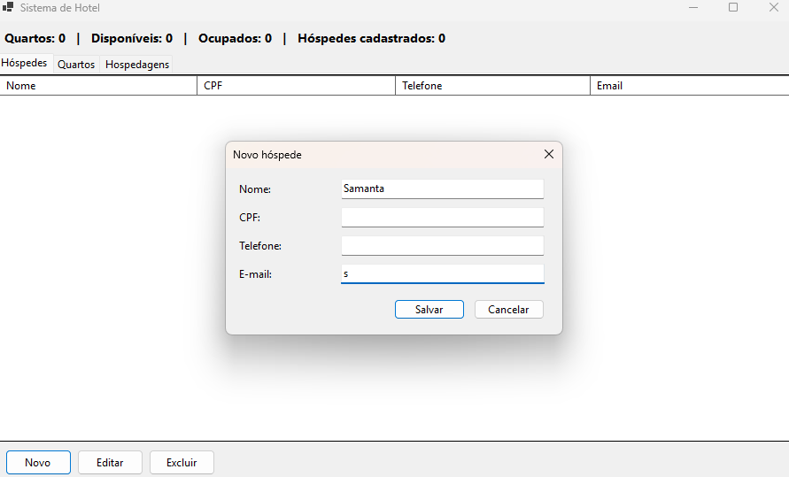

# 🏨 Hotel Management Application — C# / Windows Forms

A desktop application developed in **C# using Windows Forms (WinForms)** to simplify the registration and management of guests, rooms, and hotel stays.

The project aims to practice object-oriented programming, graphical user interface development, JSON data persistence, and business logic implementation.

## 📸 Screenshot

<p align="center">
  
</p>

## 🚀 Features

### 👤 Guest Management
- Register guests.
- Edit and delete guest records.
- Validate Brazilian CPF numbers.
- Check for duplicate CPF numbers.

### 🛏️ Room Management
- Register, edit, and delete rooms.
- Assign a unique number to each room.
- Define room type, capacity, and daily rate.
- Track room occupancy status.

### 📋 Stay Management
- Check in registered guests.
- Select only available rooms.
- Register guest check-outs.
- Calculate the total accommodation cost based on the number of nights.

### 📊 Summary Dashboard
- Display the total number of rooms.
- Display the number of available rooms.
- Display the number of occupied rooms.

## 🛠️ Technologies Used

- **C#** — programming language.
- **Windows Forms (WinForms)** — graphical user interface development.
- **.NET 8** — development platform.
- **JSON** — local data storage.

## 📋 Requirements

Before running the project, make sure you have the following installed:

- Windows 10 or Windows 11.
- [.NET 8 SDK](https://dotnet.microsoft.com/download).
- [Visual Studio 2022](https://visualstudio.microsoft.com/vs/) with the **.NET desktop development** workload, if you choose to use Visual Studio.

## ▶️ How to Run

### Option 1 — Terminal

1. Clone the repository:

   ```bash
   git clone https://github.com/Taunt-byte/App-hotel-Csharp.git
   ```

2. Navigate to the project directory:

   ```bash
   cd HotelApp
   ```

3. Run the application:

   ```bash
   dotnet run
   ```

### Option 2 — Visual Studio 2022

1. Open the `HotelApp.csproj` file in Visual Studio 2022.
2. Wait for the dependencies to be restored.
3. Press **F5** to build and run the application.

## 💾 Data Persistence

Data is stored locally in JSON files in the application's data directory, under `%AppData%\HotelApp\`.

This approach allows records to persist between application runs without requiring a database server.

## 🎯 Learning Objectives

This project was developed to practice:

- Object-oriented programming (OOP).
- Building graphical user interfaces with Windows Forms.
- CRUD operations (Create, Read, Update, Delete).
- Data validation and duplicate prevention.
- Separation of models, data access, and business logic.
- JSON serialization and deserialization.

## 🔮 Future Improvements

- Implement authentication and access control.
- Add guest search and filtering.
- Generate occupancy and revenue reports.
- Implement automated tests.
- Consider integrating a relational database.

## ⚠️ Disclaimer

This project was created for educational and portfolio purposes. Before using it in a real hotel environment, security, access control, backups, and personal data protection must be carefully evaluated, including compliance with Brazil's **General Data Protection Law (LGPD)**.

## 👨‍💻 Author

Developed as a learning project focused on C# and desktop application development.